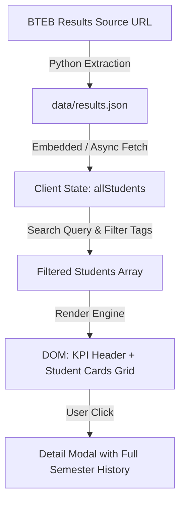

# Technical Architecture

## Tech Stack
- **HTML5 & Vanilla ES6+**: High speed, zero build-step overhead, guaranteed long-term stability.
- **Tailwind CSS (via CDN with custom theme config)**: Bespoke typography and modern aesthetic without bloat.
- **Lucide Icons**: Crisp SVG iconography.
- **Client-Side Data Store**: Pre-parsed JSON dataset embedded and available asynchronously.

## Data Flow

## Security & Privacy
- No student authentication required (results are public board results).
- Zero external tracking or ad scripts.
